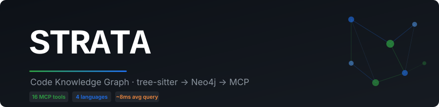
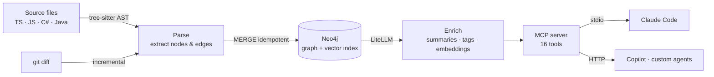
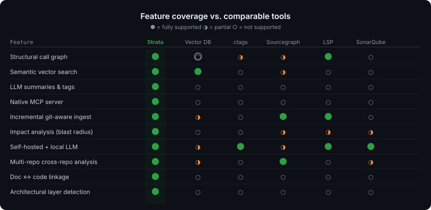

<div align="center">



<br/>

[](https://opensource.org/licenses/Apache-2.0)
[](https://python.org)
[](https://neo4j.com)
[](docs/mcp-tools.md)
[](eval-results/)

<br/>

<table>
<tr>
<td align="center">
<h3>16</h3>
MCP tools for AI assistants<br/>
<sub>stdio · HTTP · streamable</sub>
</td>
<td align="center">
<h3>~8ms</h3>
avg query latency<br/>
<sub>10-question eval suite, local Neo4j</sub>
</td>
<td align="center">
<h3>4</h3>
languages parsed<br/>
<sub>TypeScript · JavaScript · C# · Java</sub>
</td>
<td align="center">
<h3>100%</h3>
eval pass rate<br/>
<sub>10/10 questions, end-to-end</sub>
</td>
</tr>
</table>

<sub>Latency measured against a local Neo4j instance on the DevOnHire demo repo (843 nodes, 1,615 edges). See <a href="eval-results/">eval-results/</a>.</sub>

<br/>

**→ [Quick Start](#30-second-start) · [MCP Tools](#mcp-tools-reference) · [Features](#features) · [Comparison](#comparison) · [Docs](docs/)**

</div>

---

## What is Strata?

Strata turns any codebase into a **queryable knowledge graph** your AI assistant can navigate at runtime.

It uses [tree-sitter](https://tree-sitter.github.io/tree-sitter/) to parse TypeScript, JavaScript, C#, and Java into typed nodes and edges in [Neo4j](https://neo4j.com/). It enriches every node with LLM-generated summaries and semantic embeddings. Then it exposes the graph as a [Model Context Protocol](https://modelcontextprotocol.io/) server — 16 tools your assistant can call to answer questions like:

- *"What would break if I rename `IRepository.GetById`?"* → `impact_analysis`
- *"Show me the call chain from the HTTP controller to the database."* → `trace_call_chain`
- *"Which service classes have no test coverage?"* → `find_tests_for` or a Cypher query
- *"What interfaces exist in the repository layer?"* → `find_nodes(types=["Interface"], layers=["repository"])`

**The core idea:** vector search finds *what text looks like*. Strata finds *what code does* — who calls what, what tests cover a function, how deep a dependency chain is, which architectural layer a class belongs to. Use them together.

---

## 30-second start

```bash
git clone https://github.com/your-org/strata.git && cd strata
cp .env.example .env          # set SUMMARY__MODEL, add your repo volume
docker compose up -d          # starts Neo4j, Ollama, MCP server
docker compose exec strata-mcp strata bootstrap
docker compose exec strata-mcp strata ingest /mnt/your-repo --repo my-repo
docker compose exec strata-mcp strata enrich --repo my-repo
```

Open **http://localhost:7474** to query your graph.
Full guide: [Quick Start](docs/quickstart.md).

---

## The pipeline



Ingestion is **idempotent** — re-running on the same files updates existing nodes rather than duplicating them.
Git-aware incremental mode means a 5-file commit re-parses only those 5 files.

---

## Features

### 1. Structural graph extraction

No regex, no heuristic string scanning. tree-sitter produces a typed AST; Strata maps it to a strongly-typed graph schema.

| Node type | Description |
|-----------|-------------|
| `:File` | Source file (TS, C#, Java, Markdown) |
| `:Class` / `:Interface` | Types and contracts |
| `:Function` | Methods, functions, constructors, arrow functions |
| `:Document` / `:Section` | Markdown docs and heading sections |
| `:Layer` | Architectural layer (service, controller, repository, …) |

| Relationship | Meaning |
|-------------|---------|
| `CALLS` | Direct call reference between functions |
| `IMPORTS` | Import / using directive between files |
| `DEFINES` | Structural containment (class owns method) |
| `TESTS` | Heuristic test-to-production mapping |
| `MENTIONS` / `DOCUMENTS` | Doc section → code node linkage |
| `RENAMED_FROM` | File rename tracking across git history |

Every function node carries its `signature`, `line_range`, and `file_path`. **Source code is not stored in the graph** — only metadata pointers — keeping the graph lean even at enterprise scale.

---

### 2. Hybrid search with Reciprocal Rank Fusion

`find_nodes` runs two search strategies in parallel and merges the ranked results using **RRF**:

| Strategy | Index | When it runs |
|----------|-------|-------------|
| **Fulltext** | Neo4j Lucene over `name`, `nameTokens`, `summary`, `signature` | Always, even without enrichment |
| **Semantic vector** | cosine similarity over `summary_embedding` | When `use_semantic=true` and enrichment has been run |

You can filter by `repos`, `types` (node label), and `layers` — all additive AND filters.

```json
{ "query": "authentication guard", "layers": ["middleware"], "limit": 5 }
```

---

### 3. Impact analysis

Before you rename a method, `impact_analysis` tells you exactly what would break:

```
upstream  → all callers, depth-bounded, with layer info
downstream → all callees
tests     → test functions covering this node via TESTS edges
docs      → documentation sections that reference this node
layer_breakdown → { "controller": 2, "service": 4, "test": 1 }
```

Finding "this function is called by 12 controllers and has 1 test" takes a human reviewer minutes. Strata returns it in milliseconds.

---

### 4. Call chain tracing

`trace_call_chain` finds the **shortest path** between any two functions using Neo4j's native `shortestPath` algorithm:

```json
{
  "chain": [
    { "name": "Get",       "layer": "controller" },
    { "name": "GetClient", "layer": "service" },
    { "name": "GetById",   "layer": "repository" }
  ],
  "depth": 2
}
```

Useful for: onboarding ("how does a request reach the DB?"), verifying layer isolation, and mapping execution paths before a migration.

---

### 5. Automatic architectural layer detection

Every class and interface is auto-tagged at ingest time — no configuration needed:

| Layer | Name patterns | Path patterns |
|-------|--------------|---------------|
| `controller` | `*Controller` | `controllers/`, `routes/` |
| `service` | `*Service` | `services/` |
| `repository` | `*Repository`, `*Repo`, `*Dao` | `repositories/`, `dao/` |
| `model` | `*Model`, `*Entity`, `*DTO` | `models/`, `entities/` |
| `middleware` | `*Middleware`, `*Guard`, `*Filter` | `middleware/` |
| `config` | `*Config`, `*Settings` | `config/` |
| `utility` | `*Util`, `*Helper` | `utils/`, `lib/` |

Layer tags unlock powerful queries: `find_nodes(layers=["repository"], types=["Interface"])` finds every repository contract in the codebase instantly.

---

### 6. LLM enrichment (provider-agnostic)

`strata enrich` populates every node with:

- **Summary** — 1–3 sentence description of what the node does
- **Tags** — semantic labels like `["authentication", "jwt", "guard"]`
- **Complexity** — rough 1–5 score
- **Embedding** — dense 384-dim vector for similarity search

The provider is a single environment variable. Same code, your choice of inference:

```dotenv
SUMMARY__MODEL=ollama/qwen2.5-coder:7b        # local, private, free
SUMMARY__MODEL=anthropic/claude-haiku-5-5     # cloud, fast
SUMMARY__MODEL=openai/gpt-4o-mini             # cloud, OpenAI
```

Enrichment is **incremental** by default — only un-enriched nodes are processed. Run it in batches with `--limit`.

---

### 7. Test mapping & doc linkage

**Test mapping** (`strata test-map`) infers `TESTS` edges using three weighted strategies:

| Strategy | How | Weight |
|----------|-----|--------|
| CALLS graph | test has a `CALLS` path to production function | 0.6 |
| File-name heuristic | `candidate.service.spec.ts` → `candidate.service.ts` | 0.8 |
| Path mirror | `tests/services/Foo.test.cs` → `src/services/Foo.cs` | 0.7 |

**Doc linkage** (`strata link-docs`) infers `DOCUMENTS` edges from Markdown sections to code nodes — first by name matching, then by LLM-scored candidate ranking. Query "which services have no documentation?" in one Cypher call after.

---

### 8. Incremental git-aware updates

Pass `base_commit_sha` to `ingest_repo` and Strata runs `git diff` between the two commits, processes only the changed files, soft-deletes nodes from deleted files, and emits `RENAMED_FROM` edges for renames.

A 5-file commit doesn't re-parse 1,000 files. The [GitHub Actions integration](docs/features.md#12-github-actions-integration) uses this to keep large repos in sync automatically.

---

## MCP Tools Reference

Strata exposes **16 MCP tools** over both `stdio` and HTTP transports. Full docs: [MCP Tools Reference](docs/mcp-tools.md).

### Read tools (10)

| Tool | What it does |
|------|-------------|
| `find_nodes` | Hybrid keyword + semantic search with RRF — the primary discovery tool |
| `get_node` | Full details for a node: summary, tags, signature, line range, neighbors |
| `impact_analysis` | Blast radius — upstream callers, downstream callees, tests, docs |
| `trace_call_chain` | Shortest call path between two functions |
| `find_tests_for` | Test functions covering a node via `TESTS` edges |
| `find_docs_for` | Doc sections that reference a code node |
| `find_code_for` | Inverse: start from a doc section, find the code it describes |
| `semantic_search` | Pure vector similarity — conceptually related nodes without exact names |
| `list_layers` | Enumerate architectural layers and their member counts |
| `get_diff` | What changed in the graph between two ingested commits |

### Write tools (6)

| Tool | What it does |
|------|-------------|
| `ingest_repo` | Full or incremental ingest of a repository (local path or GitHub URL) |
| `reindex_file` | Re-extract and upsert a single file |
| `refresh_summaries` | Regenerate LLM summaries and embeddings |
| `run_test_map` | Infer and write `TESTS` edges |
| `refresh_doc_links` | Infer and write `DOCUMENTS` edges |
| `delete_repo` | Hard-delete all nodes for a repository (requires `confirm: true`) |

---

## Comparison



<br/>

The honest part:

| Strata is better than … | At … | They are better at … |
|------------------------|------|----------------------|
| **Vector DBs** (Pinecone, Weaviate) | Structural traversal, impact analysis, test mapping, MCP integration | Pure semantic similarity at scale |
| **ctags / universal-ctags** | LLM enrichment, semantic search, relationships beyond call sites, MCP | Zero-dependency symbol lookup, speed |
| **Sourcegraph** | Local-first, Ollama support, MCP integration, doc↔code linkage, free for self-host | Web UI, enterprise auth, regex code search |
| **GitHub Code Search** | Structural relationships, impact analysis, semantic search | Text search speed, PR-integrated UX |
| **LSP** | Queryable from AI, batch analysis, multi-repo, graph persistence | Real-time single-file navigation, IDE integration |
| **SonarQube** | AI-queryable graph, semantic search, doc linkage, free enrichment | Static analysis rules, security scanning, code smells |

**When Strata is not the right tool:**

| Scenario | Use instead |
|----------|-------------|
| Line-level test coverage | Jest/pytest coverage, Codecov |
| Runtime profiling / hot paths | OpenTelemetry, Datadog |
| Security scanning / SAST | Semgrep, Snyk |
| Semantic similarity search only | Pinecone, Weaviate, pgvector |
| IDE real-time navigation | Your language server |

Strata is designed to work **alongside** these tools, not instead of them.

---

## Use cases

<details>
<summary><strong>AI coding assistant (Claude Code, Copilot)</strong></summary>

Connect Strata's MCP server to your assistant. The assistant can now:
- `find_nodes(query="email service")` — discover existing services before creating a duplicate
- `get_node(id=...)` — read the full interface contract before implementing
- `impact_analysis(id=...)` — see who already depends on a function before suggesting changes
- `find_tests_for(id=...)` — locate tests to update when modifying a method

The assistant makes architecturally aware suggestions rather than generating code that conflicts with existing patterns.

</details>

<details>
<summary><strong>Impact analysis before a migration</strong></summary>

Before renaming `IRepository.GetById` to `IRepository.FindById` across 50 services:

```
impact_analysis(id="function:my-repo:.../IRepository.cs:GetById", max_depth=5)
```

Returns every upstream caller with depth and layer information — giving a risk estimate before a single line of code is changed.

</details>

<details>
<summary><strong>Onboarding new developers</strong></summary>

```
trace_call_chain(from_id=<controller_action>, to_id=<repository_method>)
```

Shows the exact call path from HTTP handler to database — the question that takes new joiners days to answer manually, resolved in one graph traversal.

</details>

<details>
<summary><strong>Code review automation</strong></summary>

A review agent can call `get_diff` to see what changed, then `impact_analysis` on each modified node to compute how many callers and tests are affected — flagging high-risk changes automatically.

</details>

<details>
<summary><strong>Architecture enforcement in CI</strong></summary>

After each ingest, run a Cypher query to find layer violations:

```cypher
MATCH (a:CodeNode)-[:CALLS]->(b:CodeNode)
WHERE a.layer = 'model' AND b.layer IN ['service', 'controller']
RETURN a.name, b.name, a.filePath
```

Fail the build if violations are found. Zero configuration — the layer tags come from ingest automatically.

</details>

Full catalogue: [Use Cases](docs/use-cases.md)

---

## Supported languages

| Language | Status | What is extracted |
|----------|--------|------------------|
| TypeScript / JavaScript | ✅ | Files, Classes, Functions, `IMPORTS`, `CALLS` |
| C# | ✅ | Files, Classes, Interfaces, Methods (full signature), `using`-based `IMPORTS`, `CALLS` |
| Java | ✅ | Files, Classes, Interfaces, Methods, `IMPORTS`, `CALLS` |
| Markdown | ✅ | Documents, Sections (H1–H4), `HAS_SECTION`, `LINKS_TO`, `MENTIONS` |
| Python | 🔜 Planned | — |
| Go | 🔜 Planned | — |

---

## Prerequisites

| Dependency | Version | Notes |
|-----------|---------|-------|
| Python | 3.10+ | 3.12 recommended |
| Neo4j | 5.11+ | Docker-bundled, or [Aura Free](https://neo4j.com/cloud/aura/) |
| Docker + Compose | v2 | Recommended setup path |
| Ollama | latest | For local LLM enrichment — [ollama.com](https://ollama.com) |

---

## Installation

### Docker (recommended)

```bash
git clone https://github.com/your-org/strata.git
cd strata
cp .env.example .env          # set SUMMARY__MODEL, add volume mounts for your repos
docker compose up -d          # pulls the configured Ollama model automatically
```

Starts: Neo4j on `:7474` / `:7687`, Ollama on `:11434`, MCP server on `:8765`.
All settings are environment-variable driven — no values are hardcoded in `docker-compose.yml`.

### pip (editable)

```bash
pip install -e .
# dev extras:
pip install -e ".[dev]"
```

---

## Configuration

Full reference: [Configuration Reference](docs/configuration.md).

```dotenv
# Neo4j
NEO4J__URI=bolt://localhost:7687
NEO4J__USER=neo4j
NEO4J__PASSWORD=password123

# Embedding (local — no API key needed)
EMBEDDING__PROVIDER=sentence_transformers
EMBEDDING__MODEL=BAAI/bge-small-en-v1.5

# Summary LLM — prefix determines provider
SUMMARY__MODEL=ollama/qwen2.5-coder:7b    # or anthropic/claude-haiku-5-5

# MCP transport
MCP_TRANSPORT=stdio     # stdio for Claude Code, http for agents/CI
MCP_HTTP_PORT=8765
```

---

## Connecting your assistant

### Claude Code

Add to `~/.claude/claude_desktop_config.json`:

```json
{
  "mcpServers": {
    "strata": {
      "command": "strata",
      "args": ["mcp", "stdio"]
    }
  }
}
```

### GitHub Copilot / custom agents (HTTP)

```bash
strata mcp http     # starts on MCP_HTTP_PORT (default 8765)
```

Full guide: [MCP Setup Guide](docs/mcp-setup.md).

---

## Architecture

```
src/strata/
├── cli.py                        # bootstrap / ingest / enrich / eval commands
├── config.py                     # Pydantic settings (env-driven, nested __)
├── domain/
│   ├── models.py                 # RawNode, NormalizedNode, edges, MCP I/O models
│   └── ids.py                    # stable ID builders (sig-hash for overloads)
├── graph/
│   ├── client.py                 # async Neo4j client (pooling + retry)
│   ├── migrations.py             # schema DDL — constraints, indexes, vector index
│   └── queries.py                # Cypher templates
├── ingestion/
│   ├── tree_sitter_runtime.py    # language parser — TypeScript / C# / Java
│   ├── sources/                  # per-language RawNode/RawEdge extractors
│   ├── normalize.py              # symbol registry and call resolution
│   ├── layers.py                 # architectural layer heuristics
│   ├── upsert.py                 # Neo4j MERGE pipeline
│   ├── enrichment.py             # LLM summary + embedding pipeline
│   ├── tests_mapper.py           # TESTS edge inference
│   └── docs_linker.py            # DOCUMENTS edge inference
├── mcp/
│   ├── server.py                 # FastMCP server — registers all 16 tools
│   └── tools/                   # read.py and write.py implementations
├── providers/
│   ├── embedding/                # sentence-transformers + OpenAI providers
│   └── summary/                  # LLM summaries via LiteLLM
└── eval/
    └── runner.py                 # evaluation harness (strata eval run)
```

The graph and MCP surface are versioned in [`contract/graph-contract.json`](contract/graph-contract.json). Contract tests live in `tests/contract/`.

---

## Development

```bash
# Unit tests (no Neo4j required)
pytest tests/unit/ -v

# Full test suite (requires running Neo4j)
pytest tests/ -v

# Linting and type checking
ruff check src/ tests/
mypy src/

# Run the eval suite against a live server
strata eval run --server http://localhost:8765
```

### Adding a new language

1. `pip install tree-sitter-<lang>`
2. Register the grammar in `tree_sitter_runtime.py`
3. Implement `_extract_<lang>()` traversal in the runtime
4. Add `src/strata/ingestion/sources/code_<lang>.py`
5. Wire into `cli.py` and add glob patterns to the default `--pattern`
6. Add fixtures under `tests/fixtures/<lang>/` and write unit tests

---

## Documentation

| Guide | What it covers |
|-------|---------------|
| [Quick Start](docs/quickstart.md) | Docker or local Python setup, first ingest, first query |
| [Features](docs/features.md) | Full catalogue of what Strata extracts and how it works |
| [MCP Setup Guide](docs/mcp-setup.md) | Connect Claude Code, Copilot, or a custom agent |
| [MCP Tools Reference](docs/mcp-tools.md) | All 16 tools with parameters, response shapes, and examples |
| [Configuration Reference](docs/configuration.md) | Every environment variable |
| [Use Cases](docs/use-cases.md) | RAG+graph patterns, SDD agents, code review, onboarding, and more |
| [Known Limitations](docs/limitations.md) | Language support gaps, call resolution limits, performance caveats |
| [Graph Contract](docs/graph-contract.md) | Versioned schema that integrating tools may depend on |

---

## License

Licensed under the [Apache License, Version 2.0](LICENSE).

---

<div align="center">
<sub>Built by <a href="https://github.com/deepu-roy">Deepu Roy</a> · Powered by tree-sitter, Neo4j, and FastMCP</sub>
</div>
